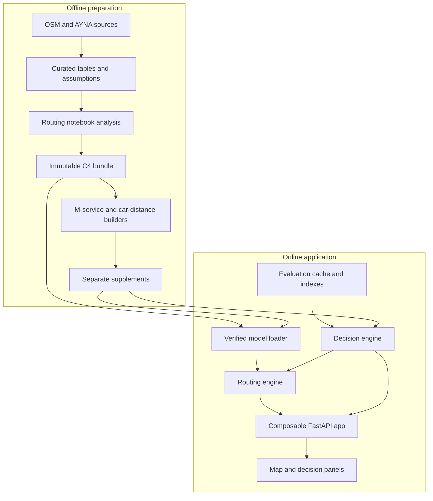
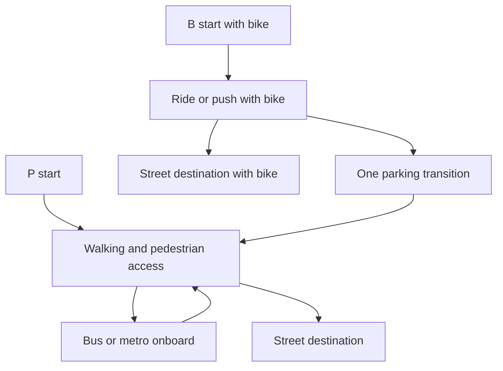
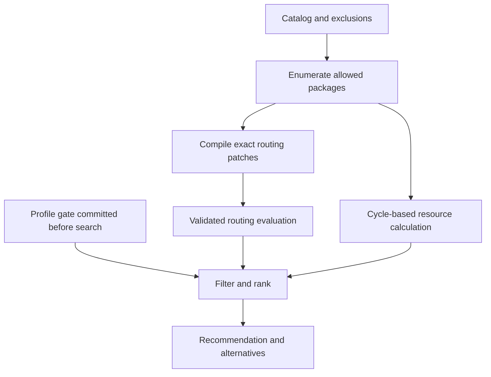

# CITYPILOT

**Explainable transport-disruption planning for a fixed Baku pilot network.**

CITYPILOT helps transport authorities compare interventions when the **Nizami–28 May metro link** is unavailable. Directed multimodal routing, resource constraints and inspectable packages answer: *which supported changes restore accessibility under this budget, and why?*

This AYNA hackathon project is a **decision-support prototype**, not a trained neural network, passenger-demand forecast, live dispatch system or production navigation service. Accessibility means reachability of equal-weight test origin–destination pairs, not measured passenger journeys or realised impact.

[Workflow](#product-workflow) · [Architecture](#architecture) · [Routing](#routing-engine) · [Decisions](#decision-engine) · [Cache](#cache-and-request-identity) · [Setup](#run-locally) · [Evidence](#results-and-verification) · [Limitations](#limitations-and-next-steps)

> **Implementation boundary.** This README describes integrated main at `28f3873`. A routing-only app is provided; decision endpoints require explicit backend injection. The separately operated demo included uncommitted startup/resource-panel glue that is **not** part of this checkout. Open follow-up [#41](https://github.com/celalthedon/ayna-hackathon-2026/pull/41) is not assumed integrated. See [documentation verification](docs/README_VERIFICATION.md) for the material gaps.

## Product workflow

1. Select **Normal**, **Kəsinti** (disrupted) or **Tədbirlərdən sonra** (mitigated), and a traveller profile.
2. Compare normal/disrupted accessibility across the fixed OD set. The disruption removes the link in both directions, not the stations or their street exits.
3. Choose additional bus-hours, construction kilometres and an action-count limit.
4. Compare feasible packages; inspect the recommendation, alternatives, resource usage and reasons.
5. Compare the AYNA reference at an equivalent model budget, inspect stress results and calculate a conditional CO₂ break-even.
6. Inspect an individual directed journey, its physical leg times, geometry and provenance.

**Individual routing and package evaluation answer different questions.** Routing inspects one saved origin/exit pair; evaluation calculates all `302 × 9 = 2,718` pairs for a configuration. Decision search ranks packages using those evaluations. A recommendation does not automatically apply its services to the map: select the matching interventions in **Tədbirlər** to inspect them there.

Normal/disrupted are controlled counterfactual baselines without express activation. Mitigated starts from disrupted topology and adds a package. They do not reconstruct every historical operational change during the closure.

## Architecture



| Component | Responsibility |
|---|---|
| `routing_engine.py` | Load verified inputs, construct request scenarios, evaluate OD times and reconstruct journeys. |
| `contracts.py` | Strict shared JSON contract 1.0, stable identities, units and validation. |
| `decision_engine.py` | Compile packages, calculate resources, enumerate/rank feasible packages, stress and CO₂ mathematics. |
| `decision_real.py`, `api_decision.py` | Bind the real catalog, gates, cache and HTTP consumers to the loaded model. |
| `precompute.py` | Offline resumable package evaluation and derived index/stress production. |
| `api.py`, `web/` | One composable server, local assets, map, inspector and optional decision panels. |

### Notebook sources, generated modules

Celal's `notebooks/01_network_routing.ipynb` uses `routing_export`; Ali's `notebooks/02_interventions_optimization.ipynb` uses `decision_export`. The exporter selects **one explicit owner/notebook/tag/output**, validates import-time AST syntax and generates a source-hashed module. It neither executes notebook analysis nor exports saved cell outputs. Never hand-edit generated engines.

Owner-specific AST allowlists reject unsafe import-time expressions. Shared contracts remain ordinary Celal-owned Python. Export parity does **not** prove clean execution of all historical analysis cells.

## Data and model preparation

OSM/Geofabrik road and subway geometry and AYNA route/stop data underpin the pilot. [Curated R2/R14 tables](data/curated/) contain directional patterns, service parameters, source records and an assumption sheet; metric processing uses **EPSG:32639**, with WGS84 coordinates at geographic interfaces. Source direction and grade topology matter: geometric crossings do not automatically create junctions. Some endpoint/grade transitions and permissions remain assumptions.

Three artifact classes serve different purposes:

- **Curated inputs:** reviewed source tables and declared parameters; not executable runtime graphs.
- **Generated supplements/display assets:** constructed M cycles, OD car distances and the browser's pilot-map geometry.
- **Immutable runtime bundle:** separately distributed graphs, arc tables, OD/access records, calibration inputs and manifest. It contains 49 hash-listed payloads plus `manifest.json`; it is not in Git.

`load_model(artifact_dir, config_dir)` verifies every payload SHA-256, the bundle hash, external baseline config equality, OD/model references and matrix dimensions. It never runs a notebook. Origins include Bakı Beynəlxalq Avtovağzal, affected-station exits and a 300 m grid within an 800 m exit radius, with a 100 m snap limit. Destinations are nine individual exits at 28 May, Sahil and Gənclik. Stable profile-aware OD IDs bind them to the OD hash.

The committed [M supplement](supplements/m_services_v1/) registers M1/M2/M3/M5/M6; M9 is excluded. Both directed road paths are constructed independently on the bus-eligible distance graph, with explicit segment lengths. Approximate stop coordinates and assumed reverse stop order are retained. `coverage=full` means a **complete constructed model cycle**, not officially verified express-route coverage. A/B service suffixes mean **6/9-minute design headways**, independent of pattern direction.

Supplement manifests extend identity with `+prebuilt@<supplement_hash>`; registration does not activate a service. Evidence distinguishes `observed`, `published`, `curated`, `modelled`, `assumption` and `unverified` without promoting assumptions to observations. See [M preparation](docs/M_SERVICE_SUPPLEMENT.md) and [R2/R14 source review](docs/decisions/G2.md).

## Routing engine

The engine uses nonnegative, directed, weighted sparse graphs and **SciPy Dijkstra on the transposed graph**. Reverse searches from the nine destination exits recover times for many origins at once; B additionally considers destination ownership states. The winning origin access option and predecessor path drive the inspector.

Grid access weighs both snapped-segment endpoints, including off-road walking/pushing and permitted directional cycling. New stops subdivide the physical segment before pedestrian attachment, preserving directional costs and saved OD access without endpoint shortcuts or forced component joins.

| Profile | Permitted behaviour |
|---|---|
| **P — Piyada + nəqliyyat** | Walk, board buses/metro, alight and transfer. No private-bike starting state. |
| **B — Şəxsi velosiped** | Start owning a bike; ride permitted directions or push it; finish carrying it, or park once and continue on foot/transit. No transit boarding while carrying it and no retrieval. |



There is deliberately no edge from parked/walking states back to bike ownership. Baseline parking availability is assumed, not live occupancy.

Boarding wait is **headway / 2**, an expected-wait assumption. Onboard continuation does not charge another boarding wait; intermediate dwell applies when continuing, not after alighting. Full-cycle terminal layover informs vehicle resources, not passenger ride time. Walking, cycling, parking, metro entry/exit and interchange costs remain explicit.

Bus timing uses saved source distances and calibrated moving speeds; display shapes use projected-stop substrings. These are not interchangeable measurements. Explicit zero-cost sparse edges survive; parallel directed connections take the **minimum**, never the sum. Disconnected geometry remains `MultiLineString` with `GEOMETRY_GAPS` and partial provenance; stationary legs can use `Point`. No invented connector bridges a display gap. Journey playback pauses at those gaps and interpolates only supplied pieces.

| Result field/status | Interpretation |
|---|---|
| `minutes`, `JourneyResult.total_min` | Physical elapsed model minutes, including access/wait/transfer. |
| `capped_minutes` | `min(minutes, C)`; unreachable pairs receive finite penalty `C`. |
| `reachable` / `over_cap` | Path exists, respectively within/above cap; above-cap physical time is retained. |
| `no_path` | No permitted path; physical minutes are `null`, not zero. |

Default `C=120` minutes is separate from accessibility thresholds `40/45/50`. `duration_ms` measures engine calculation, not travel or complete HTTP latency. [Contract details](docs/CONTRACT.md) include strict types, finite JSON, patch canonicalisation and request/result validation; historical stage-status prose there predates later activation integration.

## Decision engine

The real catalog contains four R2/R14 interval cuts (`25%`/`50%`) and ten M variants: **14 actions, seven mutual-exclusion groups**. Each line admits at most one variant. Existing groups `SG_R2`/`SG_R14` remain separate from prebuilt services. `activate_link`, `enable_parking` and BIKE construction actions are unsupported; they are not runnable candidates.



| Constraint/input | Unit and current default |
|---|---|
| `H_hours` | Three-hour analysis window. |
| `B_h` | Additional bus-hours, default 30; API/UI maximum 120. |
| `K` | Kilometres of new infrastructure requiring construction, default 2. Current service actions use zero new km. |
| `N_a` | Action count, default 3; supported maximum 5. |

Resources use complete round-trip distance, speed, intermediate dwell and full-cycle layover. Required vehicles round upward; **added bus-hours = vehicle delta × H**. A limit of 30 does not mean a package uses 30, nor that 30 buses are available. Unknown resource packages are not silently treated as free.

Enumeration includes the empty package and exclusions: **379/939/1,611 packages at N≤3/4/5**, before resource filtering. Above `max_exact_packages=3000`, the implementation returns the best baseline with an `approximate` label instead of claiming exhaustive search.

A saved, **profile-specific objective gate** is selected against that model's normal/disrupted request hashes before optimisation. P uses `count` (maximise ODs within primary T=45, then minimise capped sum); B uses `sum` (reverse those priorities). Further criteria are bus-hours, construction km, action count and stable candidate IDs. Main compares capped sums using pairwise `1e-6`-minute ties: this can be non-transitive. Quantised transitive ranking and ranking-policy identity are **not implemented here**. Exact refers to catalog enumeration, not an unconditional real-world optimality guarantee.

Stress is a 3×3 speed/headway grid. Speed factors divide **moving time of existing and activated buses only**; dwell, walking, cycling, metro and transfer costs stay fixed. Per-group headway factors affect existing services, not M design headways. Compiled percentage cuts are scenario-relative; `set_service_headway` is the exact final interval and is never multiplied again. Mitigated topology starts disrupted, including for an empty package.

AYNA comparison uses the five six-minute M variants as a **modelled reference**, not an audited operator timetable. The optimiser receives that reference's own bus-hour budget and `N_a_max` (currently 105 hours/5 actions), not the user's default 30-hour setting. Complete-index comparisons are prepared per profile without startup routing and invalidated by their gate/model/catalog/index/limit fingerprint.

## Cache and request identity

Expensive routing produces complete per-OD evaluations. `EvaluationCache` stores canonical keys/results; indexes carry ranking summaries and lazy references to full evaluations. Stored stress and AYNA comparisons are derived results. Cached answers are model evaluations, not hand-authored demo data; cache integrity is not field validation.

```mermaid
sequenceDiagram
  participant UI as UI
  participant API as Decision API
  participant Store as Index / RAM / disk
  participant Route as Routing
  UI->>API: Profile, package or limits
  API->>API: Construct canonical RoutingRequest
  API->>Store: Lookup complete identity
  alt Compatible index summary
    Store-->>API: Summary; full OD rows stay lazy
  else Validated full cache hit
    Store-->>API: Result matching request
  else Missing or incompatible full entry
    API->>Route: Evaluate immutable scenario
    Route-->>API: Shared EvaluationResult
    API->>API: validate_request before persistence
    API->>Store: Atomic full-result write
  end
  API-->>UI: Ranked result and resources
```

Routing `config_hash` includes contract/model/OD, profile/state/closure, canonical patches/factors and thresholds/primary/cap. Full cache keys also include model input hashes and evaluator scenario. Budgets filter/rank already evaluated packages and are not routing inputs. Decision HTTP stamps use their own request/model metadata; do not interpret every field named `config_hash` as the same namespace.

Full-result RAM/disk hits call shared `validate_request`; invalid hits recompute, incompatible fresh results raise before persistence. Indexes check model/scenario/profile/catalog headers and row shape, types and reconstructed request identity. **Current index checks do not enforce all numerical bounds or prove summary/full-payload equivalence**. Use trusted, independently checked artifacts, not arbitrary imported indexes.

Precompute supports count-only `--dry-run`, resume, `--index-only`, `--stress` and catalog variants. Windows-compatible **spawn** rebuilds one context per worker; evaluation writes use unique temporary files/atomic replacement. This is not a distributed scheduler or a general concurrent-writer guarantee. Findings are model/catalog-bound. Missing indexes may cause expensive first-request priming; missing full OD payloads may trigger routing even when summaries exist.

Cross-platform acceptance requires exact request identities, OD IDs/statuses and counts; physical/capped minutes and sums use absolute `1e-6` minutes. Preserve original Linux provenance and hashes rather than rewriting them to match another platform. [Verifier](tools/verify_cache_sample.py) rejects checklists without OD reference rows; acceptance tooling still needs broader adversarial validation.

## API and frontend

All routes share the existing FastAPI app; no second decision server is required. Routing loads/verifies once per app lifetime, executes CPU work outside the async loop and admits one job with **zero queue** (`429` when busy). Invalid routing JSON receives useful 4xx errors; unsupported capabilities are explicit, unexpected errors sanitised.

| Endpoint | Input → output |
|---|---|
| `GET /routing/ready` | None → readiness, model/OD/bundle/supplement identities. |
| `GET /routing/catalog` | None → shared `ModelCatalog`. |
| `GET /routing/od_metadata` | None → fixed IDs/coordinates and permitted UI choices. |
| `POST /routing/evaluate_package` | Shared `RoutingRequest` → `EvaluationResult` for every OD. |
| `POST /routing/inspect_journey?origin_id=…&destination_id=…` | Same request + saved IDs → `JourneyResult`. |
| `GET /decision/state` | None → limits, gates, index status and capabilities. |
| `POST /decision/optimize` | `profile, B_h, K, N_a` → recommendation, alternatives and resources. |
| `POST /decision/compare_ayna` | `profile` → equivalent-budget reference comparison. |
| `POST /decision/stress` | `profile, package_ids` → grid, worst point and reoptimisation. |
| `POST /decision/remove` | Package/profile + `action_id` → remaining package and marginal loss. |
| `POST /decision/co2` | Package/profile + optional distance/factors/avoided trips → coverage and break-even. |

`/` and `/citypilot` serve the UI; `/citypilot-assets` serves local assets. `/citypilot-capabilities` controls optional decision mounting. Default `citypilot.api:create_app` mounts routing only; injected backends preserve existing decision routes and prevent duplicate mounting.

**Səfər**, **Qatlar**, **Tədbirlər** and **Nəticələr** expose fixed-OD routing, layer toggles and inspector results. Routing generations discard stale responses. Mounted decision panels show package resources, stress and CO₂; profiles/recomputation require explicit care. In committed main, the left resource summary and separate **Müqayisə** tab retain placeholders. Configured limits and selected-package usage are different quantities; do not infer working left-panel wiring from labels.

Three.js renders local map geometry; height/depth and underground separation are illustrative. Playback is simulated motion using physical leg times, never live GPS. Map clicks inspect geography, not arbitrary routing endpoints. A WebGL-free 2D fallback and mobile sheets are provided.

## Run locally

Verified environment: **Windows/Python 3.13.1**. [Exact pins](requirements.txt): pandas `3.0.6`, NumPy `2.5.4`, SciPy `1.18.1`, Shapely `2.2.0`, pyproj `3.8.0`, FastAPI `0.143.3`, uvicorn `0.54.0`, plus test/HTTP/YAML/memory dependencies. Scripts add `src`; uvicorn uses `--app-dir src`. No packaged CLI/install exists.

[Local setup and explicit startup recipes](docs/RUNNING.md) cover clean checkout, bundle provisioning, baseline-only routing, M config, exact-byte gates and a fully provisioned decision composition. **A Git clone does not include the runtime bundle, complete cache, raw archives or OD car-distance output.** Obtain these separately from the maintainers; no public artifact download service is claimed.

Optional Cloudflare Quick Tunnel exposure forwards a running local server; its temporary hostname is not permanent hosting. No Linux container execution or production deployment is asserted. Docker packaging is not in this documented main.

### One end-to-end routing example

From the repo root, with `src` on the import path and the two environment variables set as in the setup guide:

```python
import os
from citypilot.contracts import EvaluationResult, JourneyResult
from citypilot.routing_engine import (
    load_model, baseline_request, evaluate_package, inspect_journey, get_od_table,
)

model = load_model(os.environ['CITYPILOT_ARTIFACT_DIR'],
                   os.environ['CITYPILOT_CONFIG_DIR'])
request = baseline_request(model, state='disrupted', profile='P')
evaluation = evaluate_package(model, request)
evaluation.validate_request(request)
assert EvaluationResult.from_json(evaluation.to_json()) == evaluation

pair = next(p for p in get_od_table(model, 'P')
            if p.origin_id == 'origin:terminal:baku_international'
            and p.destination_id == 'destination:metro_exit:44')
journey = inspect_journey(model, request, pair.origin_id, pair.destination_id)
assert JourneyResult.from_json(journey.to_json()) == journey
print('ODs within 45 min:', evaluation.within_counts[45])
print('Physical journey minutes:', journey.total_min, journey.status)
print('Capped OD-time sum:', evaluation.capped_time_sum)
```

The helper supplies strict identities/closure semantics. This evaluates all ODs and one journey; it is not a health check. Resource budgets belong to decision results.

## Results and verification

Committed [baseline parity](docs/C34_PARITY.json) and [M registration receipt](supplements/m_services_v1/verification.json) cover bundle `9457bfe9…3066`, OD `10c1b58f…6ac8` and M supplement `42a56008…835a`. Each row below represents **2,718 equal-weight model pairs**, not passenger observations. Merely registering M services leaves these no-patch values unchanged.

| Profile/state | ≤40 | ≤45 | ≤50 | Capped sum, minutes |
|---|---:|---:|---:|---:|
| P normal | 2060 | 2339 | 2496 | 94,375.406 |
| P disrupted | 636 | 1191 | 1697 | 128,583.288 |
| B normal | 2406 | 2506 | 2511 | 73,577.915 |
| B disrupted | 2406 | 2506 | 2511 | 74,039.031 |

The same committed M receipt records **P, mitigated, `SVC_M5_A`, factor=1, T=45, C=120: 1,941 within T**. Relative to disrupted 1,191, **750 is net accessibility gain** (`1941−1191`), not a count of previously lost pairs restored or real passengers.

**Restored lost pairs** intersect the normal-within-T set, disrupted-outside-T set and mitigated-within-T set (`tools/run_a6_first_real.py`). **CO₂ coverage restored** omits the normal-membership condition (`car_distance_coverage`). These definitions can differ. No historical deck restoration count is asserted without its exact OD sets; external decision reports under `outputs/` are not committed.

Verification categories include all **10,872 baseline rows**, status/capped-sum parity, request round-trips, directed journey leg sums, explicit-zero/parallel edges, activation/stress isolation, manifest corruption, cache identity, owner export safety and API/UI behaviour. See [routing performance](docs/ROUTING_PERFORMANCE.md), [geometry checks](docs/SAVED_SUBSTRING_GEOMETRY_TEST.md) and [car-distance diagnostics](docs/OD_CAR_DISTANCE_DIAGNOSTICS.md). Receipts are versioned historical evidence, not a fresh all-tests-passing badge or validation against observed journeys.

## CO₂ interpretation

The offline [car-distance builder](docs/OD_CAR_DISTANCES.md) computes directed private-car **approximations**, excluding busways while preserving source direction/grade topology and legal partial-segment costs. An explicit 100 m snap limit is assumed; snap displacement is reported separately. It computes 2,718 physical distances once and joins them to 5,436 profile-specific evaluator IDs.

Committed diagnostics report **2,664 modelled / 45 no-path / 9 snap-failed physical pairs**. Unknown distance remains null. For the package/profile's restored pairs, any required missing distance triggers manual input instead of zero or a subset mean. Multimodal journey length is never substituted for a car alternative.

Added bus CO₂ is additional departure-based vehicle-km × kg/vehicle-km. Break-even is `ceil(added_bus_kg / (car_trip_km × car_kg_per_pkm))` over the same analysis window. Factors, car occupancy/consumption and any avoided-trip input are assumptions. The national 15.4 km figure is reference-only. Break-even is not measured modal shift, causal benefit or realised emissions savings; embodied emissions and full lifecycle effects are outside this calculation.

## Limitations and next steps

- Fixed pilot geography and OD selection; no observed demand weighting, vehicle-capacity assignment, crowding or dynamic congestion feedback.
- Calibrated/assumed speeds, dwell, parking operation and metro access/transfer costs; incomplete turn/access restrictions and uncertain grade transitions.
- Approximate M boarding locations, constructed street paths and assumed return order; complete model cycles do not establish operational legality.
- R14 stop 105 alignment and schematic metro access/interchange geometry remain disclosed gaps.
- Unsupported infrastructure actions; existing bike access is not an infrastructure investment optimiser.
- Main still lacks the demo's turnkey backend/resource-summary glue; near-tie ranking and index numerical-bound limitations remain explicit above.

Next work is field validation, improved source/access evidence, demand/capacity modelling, safer derived-result validation/ranking and durable deployment packaging. Extending to a city-wide operational model requires new topology, data, validation and performance work, not a trivial configuration switch.

## Repository, team and contribution

```text
notebooks/              Owner-tagged source and historical analysis
src/citypilot/          Contracts, generated engines, real wiring, API and builders
data/curated/           Committed source tables and assumptions
supplements/m_services_v1/  Hash-bound constructed M assets and config
data/cache/             External/generated evaluations, indexes and stress (ignored)
outputs/                External bundle and generated reports/distances (ignored)
web/                    Approved UI, local map assets and Three.js
config/objective/       Profile/model-specific objective gates
requirements.txt        Exact development/runtime dependency pins
tests/                  Focused contract, routing, decision, cache and UI checks
tools/                  Export, preparation, verification and bounded experiments
docs/                   Contracts, evidence and historical handoffs
```

**Team Octopus:** Celal owns routing/shared contracts and base integration; Ali owns decision/resource/search logic and his separate notebook, as recorded in the [balanced roadmap](docs/CITYPILOT_Balanced_Notebook_Roadmap.md). **Acknowledgement: Xədicə.** Committed source handoffs do not name the research contributor; no unrecorded code/data authorship is assigned.

Use a dedicated branch and focused PR; no direct main push or automatic merge. Export only the edited owner, then run both `--check` commands from [the setup guide](docs/RUNNING.md#contributing-and-lightweight-checks). Keep immutable bundles/cache payloads separate from code PRs and never repair identity mismatches by rewriting stored hashes. Many older handoffs describe stage-time blockers; inspect current code rather than treating every historical status as current.

**Licensing:** no repository-wide software licence is committed; no general open-source permission is asserted. OSM-derived data is attributed to [OpenStreetMap contributors](https://www.openstreetmap.org/copyright) / Geofabrik under ODbL 1.0. AYNA-derived inputs retain their individual source records; no blanket third-party licence is invented. Three.js retains its [MIT notice](web/static/citypilot/THREE-LICENSE.txt). See [display-data attribution](web/static/citypilot/DATA-SOURCES.txt).
