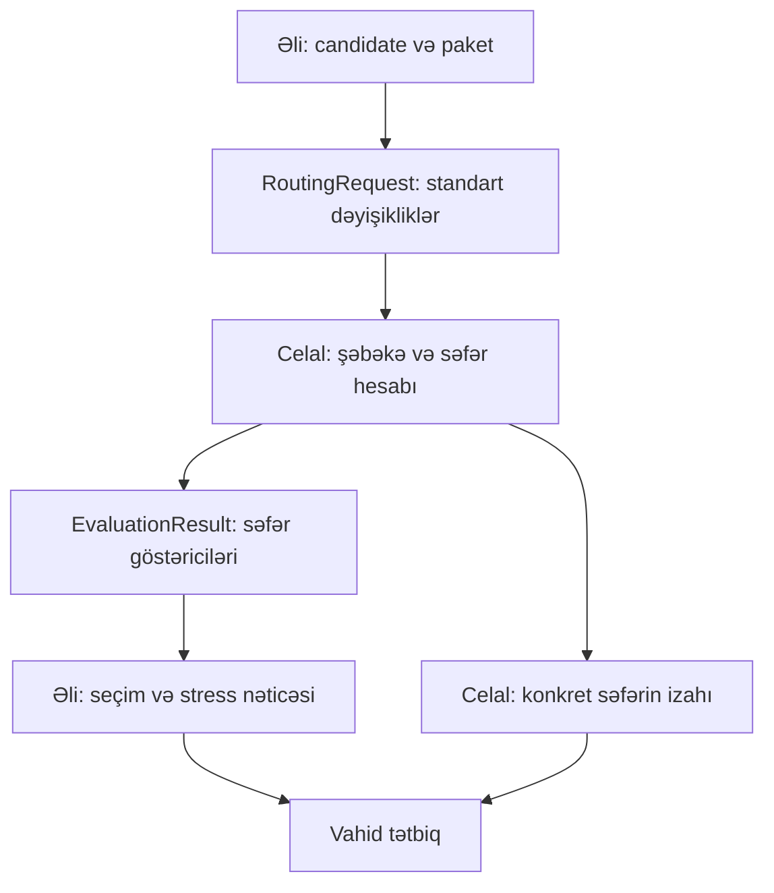

# AYNA CityPilot — Celal və Əli üçün balanslı notebook roadmap-i

**Komanda:** Octopus — Celal və Əli  
**Baza:** `CITYPILOT_FINAL_v4.md` (daxili versiya v4.1)  
**Tarix:** 17 oktyabr 2026  
**İş forması:** hər iki şəxs öz notebookunda simulyasiya qurur; tətbiq ayrı Python/JS fayllarındadır.  
**Status:** implementasiya planıdır; hazır mühərrik və təsdiqlənmiş nəticə iddiası deyil.

**Bu sənəd əvvəlki `CITYPILOT_Ali_Celal_Full_Roadmap.md` iş bölgüsünü əvəz edir.** Köhnə bölgünün promptlarını bu bölgü ilə paralel istifadə etməyin. Məhsulun bazası v4.1-dir; aşağıdakı texniki dəqiqləşdirmələr onun ziddiyyətli cümlələrindən üstündür.

## 1. Qurduğumuz məhsul

**İnsan dili ilə:** AYNA metro bağlantısını bağlayır. Sistem nümunə səfərlərin necə pisləşdiyini hesablayır. Sonra verilmiş resurslarla hansı avtobus və transfer tədbirlərini birlikdə seçməyin daha faydalı olduğunu göstərir. İstifadəçi konkret səfəri və planın fərziyyələr dəyişəndə necə davrandığını görə bilir.

Bir koridor, normal/bağlı/mitigated üç vəziyyət, xidmət məlumatı təsdiqlənərsə 2 və 14 marşrutları, mütləq Bakı Beynəlxalq Avtovağzal başlanğıcı. Köhnə KMZ-dəki M kodları 2026 əvəzedici xətlərinin təsdiqi sayılmır.

Bu, fərziyyələri açıq olan sintetik qərar sınağıdır. Faktiki sərnişin axını, doluluq, causal fayda və canlı idarəetmə iddia olunmur. 43 datasetin hamısını mühərrikə daxil etmək məqsəd deyil; qərara təsir edən uyğun məlumat istifadə edilir.

## 2. Əsas balanslı bölgü

| | **Celal: səfər və şəbəkə simulyatoru** | **Əli: tədbir və qərar simulyatoru** |
|---|---|---|
| Sadə sual | “Bu insan bu şəraitdə haradan, necə və neçə dəqiqəyə gedər?” | “Hansı tədbirləri birlikdə seçsək, verilən resursla daha yaxşı nəticə alarıq?” |
| Notebook | `notebooks/01_network_routing.ipynb` | `notebooks/02_interventions_optimization.ipynb` |
| Data | OSM, metro, çıxışlar, snap, şəbəkə topologiyası | Avtobus dayanacaq/xidmət təsdiqi, POI, fərziyyələr, tədbirlər |
| Simulyasiya | Yol, gözləmə, minmə/düşmə, transfer, P/B qaydaları, bağlanma | Tədbir dəyişiklikləri, resurslar, feasible paketlər, exact seçim, baseline, stress |
| Tətbiq | Baza API, model yükləmə, xəritə, səfər inspector-u | Decision API, paket/resurs paneli, stress paneli, ayrıca CO₂ |
| Əsas modul | `routing_engine.py` | `decision_engine.py` |
| Doğruluq | Yol və transferlər etibarlıdırmı? | Paket və seçim resurs/məqsəd qaydalarına uyğundurmu? |

**Əli yalnız data hazırlamır:** exact optimizator, resurs riyaziyyatı və stress-test onun əsas simulyasiya işidir. **Celal təkbaşına bütün mühərriki yazmır:** onun əsas məsuliyyəti doğru səfər hesabıdır.

Hər ikisində təxminən 8 əsas mərhələ var. Data gecikərsə fixture-lərlə paralel inkişaf edilir. Frontend cilası, CO₂ və refresh əsas iki mühərrik işləyəndən sonra gəlir; əlavə iş əsas hesablama vaxtını yemir.

## 3. İki mühərrik bir-birinə necə qoşulur?



Əli qrafın node/matrix daxilini dəyişmir. O, “bu xidmətin headway dəyərini dəyiş”, “bu əvvəlcədən təsdiqlənmiş bağlantını aktiv et” kimi standart dəyişikliklər yaradır. Celal həmin dəyişikliklərin fiziki qrafa necə tətbiq olunmasını yazır.

**Bir riyaziyyat, bir sahibi:** səfər vaxtı/əlçatanlıq Celalda; paket feasibility/resurs hesabı və məqsəd üzrə sıralama Əlidədir. API və frontend bunların başqa nüsxəsini yazmır.

Əli optimizatoru routing funksiyasını parametr kimi alır. `decision_engine` konkret qraf implementasiyasından asılı olmur və `routing_engine` decision modulunu import etmir. Beləliklə dövri import və notebook asılılığı yaranmır.

## 4. Birinci 30–45 dəqiqə: ortaq razılaşma

1. Hər iki Codex sessiyası v4.1-i, bu roadmap-i və repo təlimatlarını oxuyur. Mövcud kod, data arxivləri və audit faylları real yollarla müəyyənləşdirilir. Sənəddə “inspected” yazılması sizin lokal faylın hazır olduğunu sübut etmir.
2. **Celal** ilkin `contracts.py`, kontrakt sənədi və notebook exporter skeletini qurur; **Əli** giriş/çıxış və resurs sahələrini yoxlayır. Razılaşmadan sonra Celal kontraktın fayl sahibidir.
3. Əli kiçik, deterministik `fixture_evaluator` və 4-tədbir test nümunəsi hazırlayır. Bu, real şəhər nəticəsi deyil, optimizator testi kimi etiketlənir.
4. Raw/processed/model yolları və xidmət ID-ləri razılaşdırılır. Bir nümunə sorğu və cavab kontrakt testindən keçir.
5. İlk ortaq commit-dən `celal/routing` və `ali/decision` branch-ləri açılır. Ortaq faylları paralel redaktə etməyin.

**Bu mərhələnin nəticəsi:** Celal qraf qurarkən Əli heç nə gözləmədən paket məntiqini test nümunəsində yaza bilir.

## 5. Notebookdan Python moduluna keçid

| Notebook | Export hüceyrə etiketi | Yaradılan modul | Sahib |
|---|---|---|---|
| `01_network_routing.ipynb` | `routing_export` | `src/citypilot/routing_engine.py` | Celal |
| `02_interventions_optimization.ipynb` | `decision_export` | `src/citypilot/decision_engine.py` | Əli |

- Hər notebook ayrıca “Restart & Run All” ilə işləyir. Data hazırlama və analiz hüceyrələri ayrıca saxlanılır.
- `tools/export_notebooks.py` yalnız etiketli code hüceyrələrini çıxarır; deterministik sıra, generated header və aydın çıxış yolu var.
- İxrac olunan hüceyrələrdə lazımi import, funksiya/sinif və sabitlər yerləşir. Gizli notebook vəziyyəti, magic, top-level model build, network download və plotting olmur.
- Yaradılmış modullar əl ilə redaktə olunmur. Düzəliş notebookda edilir, modul yenidən ixrac olunur.
- Celal yalnız routing, Əli yalnız decision modulunu ixrac edir. Skript bir sahibin işi zamanı digərinin çıxışını yenidən yaratmamalıdır.
- Hər kəs notebook + öz generated modulu + uyğun testləri eyni commit-də verir.
- Notebooklar bir-birini import və ya icra etmir. Məlumat faylları və ortaq kontrakt vasitəsilə əlaqə saxlayır.
- Tətbiq notebook işə salmır: modulları import edir, modeli bir dəfə yükləyir, sorğuları bu funksiyalarla hesablayır.

## 6. Ortaq kontrakt — iş başlamazdan sabitlənir

### 6.1. Vahidlər və ID-lər

GeoJSON koordinatları WGS84; məsafə hesabı uyğun projected CRS-də metr; journey və headway dəqiqə; sürət km/saat; resurs bus-hours; CO₂ kg. Uzunluq km-ə çevriləndə açıq çevrilmə var. JSON-da NaN/Infinity yoxdur: `null` + status işlədilir.

Ad əsasında səssiz join yoxdur. `station_id`, `exit_id`, `stop_id`, `pattern_id`, `service_group_id`, `link_id`, `parking_id`, `candidate_id`, `origin_id`, `destination_id` sabitdir. Süni və müşahidə olunmuş inputların statusu ayrıdır.

### 6.2. Routing dəyişiklikləri

Əlinin yaratdığı `RoutingPatch` yalnız bu əvvəlcədən razılaşdırılmış növlərdən olur:

- `set_service_headway(service_group_id, headway_min)` — konkret müsbət yekun dəyər; faizləri Əli həmin ssenarinin bazasından hesablayır.
- `activate_service(service_id)` — əvvəlcədən qurulmuş, mənbə/fərziyyəsi qeyd edilmiş müvəqqəti servis.
- `activate_link(link_id)` — əvvəlcədən yoxlanmış piyada/velo bağlantısı.
- `enable_parking(parking_id)` — əvvəlcədən yoxlanmış namizəd parkinqdə P/B keçidini açır.

Namizəd həndəsəsi Əlinin cədvəlində hazırlanır; Celal onu model kataloquna qəbul edib sabit ID verir. API istifadəçisi sərbəst edge əlavə edə bilmir. Eyni obyektə zidd dəyişiklik, naməlum ID və uyğun olmayan profil/rejim aydın xəta qaytarır. Paket sırası nəticəni dəyişmir.

### 6.3. Celalın təmin etdiyi funksiyalar

```python
load_model(artifact_dir, config_dir) -> model
get_catalog(model) -> ModelCatalog
evaluate_package(model, request: RoutingRequest) -> EvaluationResult
inspect_journey(model, request, origin_id, destination_id) -> JourneyResult
```

`RoutingRequest`: contract/model/OD versiyası, normal/disrupted/mitigated state, closure ID, P/B profili, standart patch-lər, assumptions, T/C. Limitlər decision qatının məsuliyyətidir. Routing etibarlılığını Celal ayrıca yoxlayır.

`ModelCatalog`: xidmət/pattern ID-ləri, base headway, tam dövrün məsafəsi və dayanacaq/dwell sayı, layover, full/partial coverage statusu; namizəd linklərin növü/uzunluğu/provenance; parkinq və source məlumatları. Bu kataloq resurs hesabı üçün Əliyə verilir. Tam dövr yoxdursa fleet/bus-hours “known” sayılmır.

`EvaluationResult`: config/model/OD hash-ləri, OD üzrə vaxt və statuslar, 40/45/50 əlçatanlıq göstəriciləri, capped-time cəmi, müddət, xəbərdarlıqlar. Əsas raw vaxt nəticəsi Celaldan gəlir; rəqəmləri Əli və UI yenidən başqa üsulla hesablamır.

`JourneyResult`: yol həndəsəsi, reachable/over_cap/no_path statusu, ümumi dəqiqə, hər mərhələnin mode/route/pattern, minmə-düşmə nöqtəsi, walk/wait/ride/transfer dəqiqələri və mənbə statusu. Mərhələlər yekun vaxtla uyğun gəlir.

### 6.4. Əlinin təmin etdiyi funksiyalar

```python
compile_package(candidate_ids, catalog, scenario) -> CompiledPackage
validate_package(package, limits, mode, profile) -> ValidationResult
compute_resources(package, catalog, scenario) -> ResourceResult
optimize(problem, evaluator) -> OptimizationResult
stress_test(problem, package_ids, evaluator) -> StressResult
remove_action(problem, package_ids, action_id, evaluator) -> RemovalResult
```

`evaluator` konkret qrafa girişi gizlədən callable-dır: `evaluator(RoutingRequest) -> EvaluationResult`. Celal tətbiqdə real evaluator verir; Əli öz notebookunda əvvəl test fixture-si, sonra real modulu istifadə edir.

`CompiledPackage`: candidate ID-ləri, canonical patch-lər, prerequisite/exclusion/deployment məlumatı, resource statusu. `OptimizationResult`: məqsəd/tie-break, chosen package, resurslar, baseline nəticələri, feasible paket sayı, exact/approximate etiketi və runtime. `StressResult`: grid, paketlərin feasibility/nəticəsi, ən pis nöqtənin tərifi və bir yenidən seçim.

### 6.5. Konkret başlanğıc handoff-u

Əli Celala `bus_stops.csv`, `bus_patterns.csv`, `bus_services.csv`, `pois.geojson`, `candidate_assets.geojson`, `candidates.yaml`, `assumptions.yaml` verir. Sütunlar və schema kontraktda yazılır. Celal Əliyə model kataloqu, ilk real evaluator və sabit OD datasetini verir. Yalnız ID adının dəyişməsi belə bildirilir.

## 7. Fayl sahibliyi — konfliktin qarşısını alan qayda

| Yol | Sahib |
|---|---|
| `notebooks/01_network_routing.ipynb`, `src/citypilot/routing_engine.py` | Celal |
| `notebooks/02_interventions_optimization.ipynb`, `src/citypilot/decision_engine.py` | Əli |
| `src/citypilot/contracts.py`, `docs/CONTRACT.md`, `tools/export_notebooks.py` | Celal; dəyişiklik Əli ilə razılaşdırılır |
| `data/processed/network/`, `artifacts/model/` | Celal |
| `data/processed/services/`, `data/processed/pois/`, `data/processed/candidates/` | Əli |
| `config/closure.yaml`, `config/evaluation.yaml`, `artifacts/od/` | Celal |
| `config/assumptions.yaml`, `config/limits.yaml`, `config/candidates.yaml` | Əli |
| `src/citypilot/api.py`, `src/citypilot/api_routing.py` | Celal |
| `src/citypilot/api_decision.py`, `src/citypilot/co2.py`, `tools/refresh_data.py` | Əli |
| `static/index.html`, `static/map.js`, `static/journey.js`, `static/app_state.js`, baza CSS | Celal |
| `static/decision_panel.js`, `static/stress_panel.js`, `static/co2_panel.js`, panel CSS | Əli |
| `tests/test_routing.py`, `tests/test_export.py` | Celal |
| `tests/test_decision.py`, `tests/test_resources.py`, `tests/test_co2.py`, `tests/fixtures/decision/` | Əli |
| `tests/test_integration.py` | Celal inteqrasiya mərhələsində; Əli test case-ləri verir |
| `docs/DEMO.md`, təqdimat cədvəlləri | Əli; səfər nəticələrini Celal təsdiqləyir |

Raw fayllar dəyişdirilmir. Mövcud repo quruluşu fərqlidirsə ekvivalent yollar seçilib bir dəfə sənədləşdirilir; bu cədvələ görə repo kor-koranə yenidən qurulmur.

## 8. Codex sessiyaları üçün ilkin kontekst

İki ayrı sessiya/branch istifadə edin. Hər ikisinə son spesifikasiya və bu roadmap verilir. Aşağıdakı uyğun ilkin promptu bir dəfə, sonra yalnız cari mərhələnin promptunu göndərin.

### Celal sessiyasına

```text
We are Team Octopus (Celal and Ali), building AYNA CityPilot in a two-day hackathon. Read CITYPILOT_FINAL_v4.md (internal v4.1), this balanced roadmap and repo instructions. Inspect real inputs; prior audit claims are not automatically verified. Preserve existing work.

You are Celal's coding session. Own notebook-based network/routing, closure and OD configuration, routing exports, base API/map/journey UI. Ali independently owns notebook-based intervention compilation, resource accounting, optimisation/baselines, stress tests and decision panels. Follow the ownership table; never build a second decision engine.

Freeze a typed patch/evaluator contract first. Ali must be able to work against a deterministic fixture before your real evaluator exists. Export only tagged cells to an import-safe routing_engine.py. Integrate early through evaluate_package, not notebook imports. Preserve complementary interventions, grade separation, valid bike ownership and deployment rules. No live-data, measured-diversion or causal-benefit claims. Implement only the requested stage and report concrete handoff files, checks and blockers.
```

### Əli sessiyasına

```text
We are Team Octopus (Celal and Ali), building AYNA CityPilot in a two-day hackathon. Read CITYPILOT_FINAL_v4.md (internal v4.1), this balanced roadmap and repo instructions. Inspect real inputs; prior audit claims are not automatically verified. Preserve existing work.

You are Ali's coding session. Own notebook-based service/POI/candidate preparation, intervention compilation, resource accounting, exact optimisation, fair baselines and stress tests; later own decision API/panels and the separate CO2 calculator. Celal independently owns physical routing, graph mutation, closure/OD and map/journey infrastructure. Follow ownership; do not edit his graph/notebook or duplicate his router.

Use typed declarative RoutingPatch values and an injected evaluator(RoutingRequest)->EvaluationResult. Begin with a labelled deterministic test fixture; switch to Celal's real evaluator at the first handoff. Export only tagged cells to import-safe decision_engine.py. Preserve interacting actions, consistent objectives and scenario-dependent resource feasibility. Use documented input fallbacks; never invent service confirmation or benefit. Implement only the requested stage and report handoff files, checks and blockers.
```

## 9. Celalın notebook yolu

### C1 — Kontrakt və routing skeleti

**Sadə izah:** “Əli mənim qrafımı gözləmədən işləyə bilsin deyə hesablamanın giriş/çıxışını əvvəlcədən müəyyən edirəm.”

**İş:** ortaq tiplər, patch növləri, fixture sorğu/cavab, routing funksiyalarının skeleti, exporter. Notebook idxalı olmadan təmiz Python import davranışı. Əlinin fixture evaluator-u ilə schema uyğunluğu.

**Çıxış:** `contracts.py`, `CONTRACT.md`, exporter, ilkin ortaq commit.

**Bitmə meyarı:** hər iki sessiya eyni request/result formatını validate edir; exporter bir notebook üçün işləyə bilir.

```text
Implement C1: agree and freeze typed RoutingPatch/request/result/catalog contracts with Ali, create routing stubs and a deterministic tagged-cell exporter that targets one notebook at a time. Validate the shared fixture and clean imports. Do not implement Ali's resource/search logic.
```

### C2 — Şəbəkə datası və topologiya

**Sadə izah:** “Xəritədəki xətləri real yollar və düzgün bağlantılara çevirirəm.”

**İş:** OSM walk/bike/drive, metro ardıcıllığı, çıxış/terminal/parkinq snap, projected məsafələr, one-way, mode permissions, körpü/tunel ayrılığı. G9 düzəlişi əsaslandırılır və hər üç state-də eynidir. Sərhəddən çıxan alternativ və xidmət hissələri səssiz kəsilmir.

Geofabrik sadə shapefile-lərində çatışmayan access/layer məlumatını tam bildiyimiz kimi göstərməyin. Şübhəli keçid üçün əsaslandırılmış kurasiya, məhdudiyyət etiketi və ya çıxarılma tətbiq edin. Bir komponentə bağlamaq naminə keçid uydurmayın.

**Çıxış:** şəbəkə artefaktları, snap/topologiya hesabatı, versiyalı model manifesti.

**Bitmə meyarı:** terminaldan metroya yoxlanmış piyada əlaqə; təsadüfi körpü kəsişməsi keçid yaratmır; düzgün vahid və çəkilər.

```text
Implement C2: build reproducible walk/bike/drive/metro topology with stable IDs, metric lengths, valid snaps and preserved grade separation. Check metro sequence and boundary effects. Apply justified base repairs consistently across states; disclose limited access tags and unresolved links.
```

### C3 — Səfər simulyasiyası

**Sadə izah:** “İnsan harada minir, nə qədər gözləyir və harada düşür — bunları düzgün hesablayıram.”

**İş:** route/direction/pattern minmə düyünləri; headway/2 fərziyyəsi; eyni xidmətdə davamda təkrar gözləmə yoxdur. Metro platforma/çıxış/interchange vaxtı; fiziki dəqiqə ilə generalised cost ayrıdır. Əlinin cədvəlləri ilə bus pattern; tam dövr coverage kataloqda.

P profilində velosiped yoxdur. B profilində istifadəçi öz velosipedi ilə başlayır, yalnız park nöqtəsində saxlayır, başqa yerdə geri almır; bike ilə transit boarding məhdudiyyəti tətbiq edilir. Walking with bike qaydası qeyd olunur.

**Çıxış:** normal/bağlı `evaluate_package`, `inspect_journey`; mərhələ və həndəsələr.

**Bitmə meyarı:** no-change eyni, bağlı link keçilmir, pulsuz route/direction dəyişmə yoxdur, bike testləri keçir; terminal və bus transfer səfəri yoxlanıb.

```text
Implement C3: valid multimodal boarding/transfers, curated directional bus patterns, P/B ownership states, normal/disrupted evaluation and itinerary reconstruction. Enforce closure semantics and separate elapsed time from optional penalties. Add targeted routing invariants and inspect a terminal and bus-transfer journey.
```

### C4 — Sabit OD və real evaluator təhvili

**Sadə izah:** “Eyni sınaq səfərlərini sabitləşdirib Əliyə artıq real hesablayan funksiya verirəm.”

**İş:** nəticə baxılmadan təsdiqlənmiş OD qaydasından origin/destination artefaktı yarat; terminal daxil. Closure siyahısı xidmət topologiyasından gəlir. T=45 və 40/50, C=120; over-cap/no-path statusunu ayır. Əliyə normal/bağlı OD vaxtları və tam model kataloqu ver.

Notebook ilə ixrac edilən modulun eyni sorğusunu ayrıca prosesdə müqayisə et. Başqa kompüterdə lokal absolute path-dən asılı olmayan bundle manifesti hazırla.

**Çıxış:** evaluator alpha, model + OD bundle, sorğu/gözlənilən cavab, commit ID.

**Bitmə meyarı:** Əli notebookunu açmadan real evaluator-u çağırır və bir paket üçün cavab alır.

```text
Complete C4: freeze and persist the predeclared OD/closure rules, export the real evaluator and catalog, verify notebook/module parity in a clean process, and hand Ali a reproducible model bundle and normal/disrupted requests. Never tune OD to manufacture results.
```

### C5 — Tədbirlərin fiziki şəbəkəyə tətbiqi

**Sadə izah:** “Əlinin ‘bu tədbiri et’ əmri şəbəkədə düzgün dəyişiklik yaratsın deyə tətbiq hissəsini yazıram.”

**İş:** dörd patch növü; əsas modeli mutasiya etmədən ssenari tətbiqi; naməlum ID/zidd patch yoxlaması. Yeni velobağlantı sadəcə label deyil, əsaslandırılmış qraf dəyişikliyidir. Namizəd parkinq yalnız B-də lazımi keçidi açır. Yeni servis və bağlantı kataloqla əlaqəlidir.

Əli resurs və prerequisite yoxlayır, Celal fiziki routing etibarlılığını yoxlayır. Eyni paketin patch sırası nəticəni dəyişmir. Yalnız route geometry-ni ən qısa drive path ilə əvəz edib faktiki marşrut kimi təqdim etməyin; path kurasiyası və fərziyyə açıqdır.

**Çıxış:** mitigated evaluator, bütün dəstəklənən patch-lərin davranış nümunələri.

**Bitmə meyarı:** eyni base iki sorğudan sonra dəyişmir; hər aktiv tədbir gözlənilən obyektə tətbiq olunur; complementary cüt işləyə bilir.

```text
Implement C5: apply Ali's declarative service/link/parking patches without mutating the base model. Validate identifiers, conflicting patches and physical routing rules. Register reviewed candidate assets and return reproducible mitigated metrics. Verify meaningful connector effects and interacting actions without adding an optimiser.
```

### C6 — Baza API, xəritə və səfər inspector-u

**Sadə izah:** “Hesablanmış yolu, vaxtı və bağlanmanı istifadəçi xəritədə görsün.”

**İş:** FastAPI app, modelin bir dəfə yüklənməsi, health/catalog/layers/evaluate/journey endpoint-ləri. Əlinin ayrıca decision router-i app-ə qoşmaq üçün bir mount nöqtəsi. Leaflet xəritəsi, üç state görünüşü, mənbə tarixləri və itinerary.

`app_state.js` ortaq config və request ID-ni idarə edir. Əlinin paneli razılaşdırılmış mount elementinə yerləşir; onun JS-i ayrıca qalır. Hər nəticə config hash ilə bağlanır; gecikmiş köhnə cavab yeni cavabı əvəz etmir. CPU hesabı event loop-u bloklamayan uyğun sync/worker yanaşması ilə məhdudlaşdırılır.

**Bitmə meyarı:** tətbiq notebook açmadan real səfər göstərir; nəticə yoxdursa status aydındır; Əli panelini əsas HTML-i dəyişmədən qoşa bilir.

```text
Implement C6: base API/model lifecycle, routing endpoints, Leaflet three-state map and itinerary inspector. Define one decision-router mount and frontend panel/state interfaces for Ali. Render engine outputs without duplicate calculations; handle pending, invalid, unreachable and stale-response states.
```

### C7 — Routing performansı və inteqrasiya testləri

**Sadə izah:** “Əlinin yüzlərlə paketi yoxlaması üçün hesablamanı doğru və kifayət qədər sürətli saxlayıram.”

**İş:** laptopda real evaluator vaxtı/yaddaşı ölç. Origin×node dense nəticə matrisinin ölçüsünü hesabla, lazım olsa batch-lə. Cache key model, data, OD, state, profil, canonical patch, fərziyyə və T/C-ni əhatə edir. Əlinin objective/resource cache-i ayrıca uyğun versiyalanır.

Məqsəd və gate seçiminə Celal özü müdaxilə etmir; Əlinin normal/bağlı vaxt tələbinə cavab verir. Cache-dən köhnə fərziyyə qayıtmır; repeated config deterministikdir.

**Bitmə meyarı:** real route + decision çağırışı ölçülüb; konkret bottleneck aradan qaldırılıb; tələb olunmayan optimallaşdırma işi açılmır.

```text
Implement C7: benchmark evaluator latency/memory on the actual laptop and Ali's package workload. Optimise measured bottlenecks using safe batching/caching, preserve deterministic metrics and full versioned keys, and add end-to-end contract tests with Ali's exported decision module.
```

### C8 — Səfər doğruluğu və son təhvil

**Sadə izah:** “Tətbiqin göstərdiyi yolların və rəqəmlərin düzgün olduğunu son dəfə təsdiqləyirəm.”

**İş:** hər state-də representative səfərlər, terminal və saxlanmış G9 çıxışları, direction/boarding/P-B, no-change və bağlı link. Notebook clean run + export parity. Əli ilə sərbəst parametr dəyişikliyi sınağı.

**Çıxış:** routing acceptance hesabatı, ölçülmüş müddətlər və məhdudiyyətlər; final model versiyası.

```text
Complete C8: clean-run/export the notebook, verify module parity and routing invariants, inspect representative journeys in all states including the terminal/G9 cases, and hand off measured runtime, model versions and precise limitations for the pitch.
```

## 10. Əlinin notebook yolu

### A1 — Fixture və decision skeleti

**Sadə izah:** “Celal qrafı qurarkən mən də tədbir seçimini kiçik, cavabı əvvəlcədən bilinən sınaqda yazmağa başlayıram.”

**İş:** ortaq kontraktı yoxla; `decision_export` hüceyrələri və injected evaluator funksiyası. 4-tədbir nümunəsində büdcə, alternativ variant, prerequisite və tamamlayıcı tədbir cütü olsun. Bu fixture real şəhərin sadələşdirilmiş proqnozu kimi göstərilmir.

**Çıxış:** decision skeleti, test evaluator və məlum gözlənilən paketlər. Notebook Celalın qrafını və modulunu import etmədən test rejimində işləyir.

**Bitmə meyarı:** evaluator dəyişdirilməklə eyni search kodu fixture və gələcək real model üçün işləyə bilir.

```text
Implement A1: notebook-based decision scaffolding with an injected typed evaluator and a clearly synthetic, hand-solvable four-action fixture. Include resource limits, exclusions and a complementary pair. Validate Celal's contracts and clean decision-module export; do not implement physical routing.
```

### A2 — Avtobus, POI və fərziyyə girişləri

**Sadə izah:** “Avtobusların harada dayanıb hansı istiqamətdə getdiyini dəqiqləşdirir, çatmayan rəqəmləri açıq fərziyyə kimi yazıram.”

**İş:** 43 dataset arxivi/manifesti yoxla; kritik inputları prioritetləndir, hamısını yenidən araşdırmaqla gün itirmə. OSM yaxın dayanacaqları namizəd götür, route-service/order üçün rəsmi mənbə və ya insan təsdiqi al. Hər stop/pattern üçün source və evidence saxla. Geometry/vertex sırası istiqamət sübutu deyil.

`bus_stops.csv`: stop ID, ad, lon/lat, source, evidence. `bus_patterns.csv`: route/direction/pattern ID, ordered stop ID, sequence, source. `bus_services.csv`: service group, pattern-lər, headway, speed, dwell, layover və full/partial coverage. Eyni avtobusun gediş/qayıdışını iki dəfə fleet saymamaq üçün qruplaşdırma açıqdır.

Tam dövr yoxdursa koridor parçasından tam donanma hesablanmır. Tamlıq əldə edilmirsə, açıq fərziyyəli ayrıca koridor servisi fallback-i seçilir və 2/14-ün faktiki əməliyyat modeli kimi təqdim edilmir. T0+3 saatda G2 confirmed/assumed qərarı qeyd olunur.

POI ən çox 8, mənbə və ad uyğunluğu ilə; çatmırsa stansiya çıxışları. Fərziyyələr vahidli və stress səviyyələri ilə bir config-də saxlanılır.

**Bitmə meyarı:** Celal direction uydurmadan routing qura bilir; çatmayan sahə varsa konkret status və işlək fallback var.

```text
Implement A2: validate real critical inputs and curate sourced directional service records for routes 2/14, service-group coverage, POIs and unit-labelled assumptions. Proximity is not service confirmation. Deliver a small schema-valid bundle early; at T0+3h record verified service or the explicit prototype fallback. Do not infer full-cycle fleet from partial stops.
```

### A3 — Tədbir kataloqu və resurs riyaziyyatı

**Sadə izah:** “Sistemin seçə biləcəyi tədbirləri və hər birinin nə tələb etdiyini müəyyən edirəm.”

**İş:** 8–10 əsaslandırılmış candidate hədəfi; çatdırmaq çətin olsa keyfiyyətli 5–6. Interval variantları, kurasiya edilmiş servis, real piyada transferi, konkret velo bağlantısı və ehtiyac varsa parkinq. Base-network G9 düzəlişi candidate deyil.

Hər tədbir: sabit ID, təsir etdiyi service/link/parking, dəyişiklik, prerequisite, exclusion group, immediate/planning uyğunluğu, deployment müddəti, resurs və mənbə. Tikinti tələb edən piyada bağlantısı immediate olmur. Planning immediate-ni əhatə edə bilər, amma büdcə və eligibility açıq tətbiq olunur.

Celal ilə candidate asset həndəsəsini və fiziki patch təsirini razılaşdır. Velo label-ı yol vaxtını dəyişmirsə fayda uydurma. Parkinq və connector cütünü solo faydasız deyə silmə.

**Resurs düsturları:**

- `cycle_min = full_cycle_km / speed_kmh * 60 + total_dwell_min + layover_min`.
- `vehicles = ceil(cycle_min / headway_min)`; hər unikal service group üçün.
- `added_bus_hours = sum(vehicles_new - vehicles_base) * H`; yeni xidmət üçün baza 0. Mövcud seçimlər yalnız əlavə xidmət olduğundan mənfi delta uyğunsuzluğu yoxlanılır.
- Əlavə xidmət aktiv olmayan base-də resurs hesablanmır. Eyni servis paketdə təkrar sayılmır.
- Resursları həmin stress ssenarisinin həm baza, həm yeni headway/sürəti ilə hesabla; ceil səbəbindən interval yaxşılaşması bəzən əlavə bus-hour yaratmaya bilər. Bu model limitidir, səssiz saxta minimum xərc əlavə etmə.
- Yeni infrastruktur K büdcəsi bütün uyğun yeni piyada/velo linklərinin unikal uzunluğunu əhatə edir; action count hər seçilən tədbiri sayır. Parkinqin ayrıca sayı action count-a daxildir.

Bu sadələşdirilmiş təmin edilən xidmət resursudur; real driver duty, çıxış-depo və tələbə əsaslanan fleet ehtiyacı deyil.

**Çıxış:** `candidates.yaml`, `limits.yaml`, package compiler və tək authoritative `compute_resources`.

**Bitmə meyarı:** vahid, rounding, service-group və double-count testləri; konflikt/prerequisite; P profilində bike-only tədbir davranışı müəyyənləşib.

```text
Implement A3: reviewed candidate definitions, declarative patch compilation and authoritative resource accounting. Use complete service-group cycle facts, scenario-specific baseline/new headways, compatible units and explicit deployment/profile rules. Prevent duplicate fleet/link counting and mutually exclusive options. Preserve interacting actions and disclose simplified resource limits.
```

### A4 — Məqsəd, exact seçim və baseline-lar

**Sadə izah:** “İmkanımıza uyğun bütün tədbir kombinasiyalarını müqayisə edib ən yaxşısını tapıram.”

**İş:** exact feasible-subset enumeration; 10 ikili candidate üçün maksimum 1,024 subset, real feasibility əvvəl filtr olunur. Məqsəd/tie-break lexicographic və deterministikdir. İlkin primary T daxilində OD sayı; secondary `sum(min(t,C))` minimallaşdırılması; sonra bus-hours, infrastructure km və action count.

Celalın normal/bağlı qiymətləndirməsi gəldikdə v4.1 gate qaydasını dəqiq formal predicate kimi yazıb optimallaşdırmadan əvvəl qərarı commit et. 40/45/50 üçün əvvəlcədən müəyyən threshold sensitivity; OD/T-ni yaxşı nəticə üçün dəyişmə. Continuous məqsədə keçilirsə tie-break uyğun dəyişir.

Gate-in konkret yazılışı: hər T üçün `lost_T` normalda T daxilində olub bağlanmadan sonra T-dən çıxan OD sayıdır; `fraction_T = lost_T / total_OD`. Üç T-nin **hamısında** `(lost_T < 20) OR (fraction_T < 0.10) OR (fraction_T > 0.90)` doğrudursa primary capped-time cəminin minimallaşdırılmasına keçir. Bu halda tie-break əvvəl T daxilində OD sayını artırmaq, sonra eyni resurs sırasıdır. Bu hədlər əvvəlcədən seçilmiş layihə qaydasıdır, statistik test deyil. `total_OD = 0` gate seçimi deyil, düzəldilməli giriş xətasıdır.

No-action, nearest-gap və greedy eyni candidate, profil, limit və məqsədlədir. Bir neçə resurs üçün greedy nisbəti qeyri-müəyyən qalmasın: müsbət limitlərə normallaşdırılmış resurs istehlaklarının maksimumundan istifadə edin, sıfır limitə müsbət xərc infeasible olsun; action count da xərcdir. Primary gain 0 olduqda razılaşdırılmış secondary müqayisə və deterministik ID tie-break-i tətbiq edin. Baseline heuristikası qeydə alınır, qlobal zəmanət verilmir.

Prerequisite tələb edən candidate-ları baseline-da necə əlavə etdiyinizi aydın yazın: prerequisite-ləri də paketə daxil edib bütün resurslarını sayın; mümkün deyilsə buraxın. Exact axtarış onları itirmir. Nearest-gap üçün service tədbirinin məkan təmsili curated stop dəsti kimi əvvəlcədən təyin edilir; itirilmiş cüt yoxdursa fallback rank qaydası açıqdır.

Nearest-gap üçün lost origin yoxdursa vaxtı pisləşən origin-ləri, onlar da yoxdursa əvvəlcədən sabit origin dəstini istifadə edin; son bərabərlik candidate ID sırasıdır. Məkan təmsili tədbir kataloqunda qeyd edilir. Bu qayda nəticə görüldükdən sonra baseline-ı zəiflətmək üçün dəyişdirilmir.

**Bitmə meyarı:** hand-solved fixture nəticəsi doğrudur; feasible paketlər limiti aşmır; exact heç vaxt uyğun baseline-dan pis objective vermir; həqiqi bərabərlik gizlədilmir.

```text
Implement A4: exact feasible-package search, predeclared objective/gate and deterministic no-action/nearest-gap/greedy baselines under identical rules. Define multi-resource normalisation, zero-limit and prerequisite-bundle behaviour. Verify hand-solved and complementary-action fixtures. Do not discard zero-solo-gain actions or tune OD/thresholds after outcomes.
```

### A5 — Stress simulyasiyası və tədbir çıxarma

**Sadə izah:** “Avtobusun şəraiti pisləşəndə planımızın nə qədər etibarlı qaldığını yoxlayıram.”

**İş:** 3 headway × 3 speed grid; faizli tədbir hər grid nöqtəsinin bazasından hesablanır. Eyni limitlər altında yeni cycle/fleet/feasibility. Paket yalnız feasible nöqtədə feasible kimi qiymətləndirilir; infeasible ayrıca göstərilir.

Baza top-3 planın nəticəsi, worst-case tərifi və bir ən pis nöqtədə exact yenidən optimallaşdırma. Bu, bütün grid-də qlobal robust optimum iddiası deyil. Bir tədbir çıxarılanda compiler/validator yenidən işləyir; prerequisite pozularsa gizli auto-fix əvəzinə infeasible və səbəb göstərilir.

Conditional tədbir faydaları toplanıb package faydası kimi təqdim olunmur. Keş konfiqurasiya, model, OD, objective, profil, limits, grid və paketə görə versiyalanır; əsas routing cache-i Celaldadır.

**Bitmə meyarı:** ssenari dəyişəndə həm routing, həm resurs dəyişir; ən pis nöqtənin və re-optimisation nəticəsinin izahı var.

```text
Implement A5: top-package 3x3 headway/speed stress evaluation, scenario-consistent patch/resource updates, feasibility labels and one exact re-optimisation at a clearly defined worst point. Add remove-one-action with prerequisite failures. Distinguish conditional effects, scenario ranges and bounded comparisons from causal or global robustness claims.
```

### A6 — Real routing ilə decision modulu təhvili

**Sadə izah:** “Test nümunəsini Celalın real hesablaması ilə əvəz edib iki hissənin birlikdə işlədiyini göstərirəm.”

**İş:** fixture evaluator yerinə real adapter; başqa optimizator yazılmır. Notebook/module parity; compiler-in yaratdığı patch Celalın kataloqunda tanınır. Eyni config üçün metric hash uyğundur. Kiçik real candidate dəstində exact + baseline + remove-one; əvvəl correctness, sonra tam dəst.

**Çıxış:** decision alpha/final, model uyğunluq versiyası, bir optimize/stress sorğusu və nəticəsi, testlər.

**Bitmə meyarı:** üçüncü Python prosesində hər iki modul import olunur, normal/bağlı/mitigated və paket seçimi eyni config ilə işləyir.

```text
Complete A6: replace only the fixture adapter with Celal's real evaluator, verify patch/catalog and notebook/module parity, and export decision_engine.py. Run a small real exact/baseline/removal workflow and provide reproducible versioned requests/results. Keep fixture results out of product metrics.
```

### A7 — Decision API, panellər və ayrıca CO₂

**Sadə izah:** “İstifadəçi resursunu seçsin, planları müqayisə etsin və fərziyyəli ekoloji nəticəni görə bilsin.”

**İş:** ayrıca `APIRouter`: optimize/stress/remove/co2. Celal app-ə bir dəfə mount edir. `decision_panel.js`, `stress_panel.js`, `co2_panel.js` razılaşdırılmış DOM mount/state interfeysindən istifadə edir. Əsas HTML və `map.js` paralel redaktə olunmur.

UI B_h/K/N_a, mode/profil və result statusunu göstərir; request config hash-i saxlanır. Celalın app-state dəyişikliyi ilə panel nəticələri outdated olur. Gözləmə/error/infeasible/no-result aydındır. Eyni göstəricini JS-də ikinci formul ilə hesablamayın.

CO₂ ayrıca user-input ssenarisidir: avoided car passenger-km × compatible kg/pkm − əlavə bus vehicle-km × kg/vkm və tətbiq edilirsə digər incremental emissiyalar. OD sayı real avoided trips deyil. Network itinerary uzunluğu avtomobilin əvəz edilən məsafəsinə avtomatik bərabər deyil; user təsdiqi və ya ayrıca car məsafəsi/fərziyyəsi tələb olunur. National fleet mix yerli emissiya faktorunu təsdiqləmir. Mənfi nəticə saxlanılır.

Bus vehicle-km-ni dwell/layover daxil fleet-hours × speed kimi götürməyin: xidmət departure/cycle əsaslı hesab və ya manual input istifadə edin. Müqayisə edilən dövr eynidir; embodied emissions xaricdirsə qeyd olunur. Mənbəsiz faktor user input olaraq göstərilir.

**Bitmə meyarı:** API uyğun payload-la işləyir; frontend backend nəticəsini göstərir; CO₂ vahid və mənfi nəticə testləri keçir.

```text
Implement A7: standalone decision API router and independently mounted package/stress/CO2 panels using Celal's app-state contract. Show returned configuration/feasibility and stale/loading states. Keep CO2 unit-safe and assumption-based; never infer avoided trips or car distance from accessibility automatically. Do not edit Celal's app/map files.
```

### A8 — Provenance, yüngül refresh və demo

**Sadə izah:** “Nəticələrin hansı məlumatdan gəldiyini göstərir və təqdimat üçün hazır vəziyyətə gətirirəm.”

**İş:** manifest və source dates; vaxt qalırsa kiçik CKAN refresh: fetch→validate→yeni snapshot. Aktiv model səssiz yenilənmir; Celal model rebuild/version change ilə qoşur. Fetch vaxtı ilə source update vaxtı ayrı göstərilir. Son düzgün data saxlanılır.

Demo skripti və baseline cədvəli; rəqəmlər real output-dandır. Sərbəst dəyişiklik sınağı, backup recording. Real-time feed qoşulmayıbsa refresh göstərmək “live” sayılmır. İnternet fallback planını Celalla yoxla; yerli JS asset-ləri, mənbə attribution-u və uyğun tile istifadəsi.

**Çıxış:** decision acceptance hesabatı, source/fallback qeydləri, `DEMO.md`, backup. Refresh əsas mühərrikdən vaxt almamalıdır.

```text
Complete A8: finalise provenance, measured decision results and acceptance checks, prepare the three-minute demo and unscripted change with Celal, and add a small validated refresh command only if core work is stable. Preserve last-good snapshots and explicit model invalidation. Document limitations and prepare a network-failure fallback.
```

## 11. Erkən inteqrasiya — sona saxlamırıq

**I0 — Kontrakt inteqrasiyası:** shared fixture schema-dan keçir. Hər iki modul stub/fixture səviyyəsində ayrı import olunur.

**I1 — İlk real səfər:** Celal normal/bağlı evaluator verir; Əli eyni interfeyslə bir real nəticə alır. Əli optimizatorun əsas kodunu dəyişməməlidir.

**I2 — İlk real tədbir:** Əlinin compiler-i bir headway patch-i yaradır, Celalın evaluator-u qəbul edir; gözləmə dəyişir, resurs Əlidə hesablanır. Bir patch üçün müqavilə problemidirsə tam search-ə keçməyin.

**I3 — Tam nüvə:** exact + baseline + üç state + journey UI. Model/OD/config versiyaları eyni; seçilən paketdən bir tədbir çıxarılır.

**I4 — Stress və son demo:** bir parametr dəyişir, routing və resource feasibility birlikdə yenilənir. Paket dəyişməsə də nəticə dürüst göstərilir.

Sonda iki notebooku birləşdirmirsiniz. Repo içində iki modul + nazik tətbiq adapteri olur. Əli `api_decision.py` içində decision-ı, Celal `api_routing.py` içində routing-i çağırır; `api.py` bunları qoşur. Nəticə istifadəçi üçün bir tətbiqdir.

## 12. İki günlük praktik vaxt bölgüsü

**T0 faktiki başladığınız andır.** Aşağıdakılar planlama bloklarıdır, tədbirin rəsmi təhvil vaxtı deyil. Mövcud hazır iş nəzərə alınaraq blok qısaldılır; keçmiş 09:00/12:00 deadline-lar təkrar istifadə olunmur.

| Blok | Celal | Əli | Birgə nəticə |
|---|---|---|---|
| İlk 30–45 dəq | C1 kontrakt/exporter | A1 fixture və kontrakt baxışı | I0; iki branch |
| Sonrakı 2–2.5 saat | C2 şəbəkə, closure/OD qaydası | A2 bus/POI/assumption; ilkin A3 | T0+3h G2 qərarı və ilkin data bundle |
| Sonrakı 2–3 saat | C3 routing/P-B | A3 resurs/compile; A4 fixture search | Real evaluator-a hazır iki hissə |
| Sonrakı 1–2 saat | C4 alpha; C5 ilk patch | A4 search; A6 real adapter | I1 və I2 |
| Növbəti 3–4 saat | C5 tamamlanma; C6 baza API/xəritə | A4 real gate/search; A5 stress məntiqi | I3: işlək məhsul nüvəsi |
| Sonrakı 2–3 saat | C6 inspector; C7 performans | A6 export; A7 decision panelləri | UI-dən real package seçimi |
| Son 2–3 saat | C8 son yoxlamalar | A7 CO₂ vaxt varsa; A8 demo | I4, stabil release və backup |

**Balans:** Celalın şəbəkə işi uzanırsa Əli A4/A5-ni fixture üzərində tamamlaya bilər; Celala gözləmə yaranmır. Əlinin stop təsdiqi uzanırsa Celal fixture service ilə C3-ü davam etdirir, real-data iddiası isə G2 qərarına bağlı qalır. UI vaxtında çatmırsa əlavə panellər/CO₂/refresh kəsilir; əsas hesablama bir nəfərin üzərinə yığılmır.

## 13. Data və texniki risklərin məcburi qaydaları

1. **Complementarity:** solo gain=0 tədbiri silmək olmaz. Exact search onu uyğun kombinasiyada yoxlayır. Əsassız candidate şişirtmək də lazım deyil.
2. **Velobağlantı:** yalnız faktiki graph permission/connection/cost dəyişikliyi modelləşdirilirsə fayda hesablanır; label-dan süni zaman qazancı yaranmır.
3. **Direction və grade separation:** loop order və xətt kəsişməsi fiziki xidmət/keçid sübutu deyil. Əli service order, Celal fiziki topology üçün cavabdehdir.
4. **Tam dövr:** full-cycle məlum deyilsə full fleet hesabı təsdiqlənmiş deyil. Koridor shuttle fallback-i tam dövr və fərziyyələri ilə ayrıca verilir.
5. **Baseline semantikası:** normal/disrupted eyni assumed services ilədir, yalnız metro link çıxarılır. Curated express yalnız candidate olaraq state 3-ə daxil olur. Bu, real tarixi replay kimi təqdim edilmir.
6. **P/B ayrılığı:** P profili bike faydasını almır. B istifadəçisi hər yerdə velosiped tapa bilmir.
7. **Objective gate:** precommitted OD/T/C və əvvəlcədən yazılmış keçid qaydası. Əli gate-i icra edir, Celal raw evaluation verir.
8. **Immediate/planning:** deployment üçün fizik olaraq mümkün olmayan tədbir immediate paketə girmir. Planning sərhədləri və bütün resurs limitləri aydındır.
9. **Nəticə etiketi:** hesablanan OD cütləri actual sərnişin sayı deyil. AUC/36%/102k t kimi geri götürülmüş iddialar pitch-ə qayıtmır.
10. **Mənbə:** audit statistikaları code/output ilə təsdiqlənməyibsə “spec author reported” və ya unverified statusu saxlanılır; yenidən avtomatik verified yazılmır.

## 14. Git və təhvil intizamı

- Ortaq baza commit-i → `celal/routing` və `ali/decision`.
- Bir şəxs yalnız öz notebookunu və əsas modulunu redaktə edir. Ortaq contract dəyişikliyi əvvəl razılaşdırılır, sonra kiçik commit-lə hər iki branch-ə ötürülür.
- Hər mərhələdə kiçik işlək commit. Export edilmiş modul notebookla birlikdədir; diskdə köhnə generated fayl saxlanılmır.
- I1/I2 üçün erkən inteqrasiya commit-ləri əsas branch-ə daxil edilir. Son gün bir nəhəng merge planlaşdırılmır.
- Merge-dən sonra minimal smoke: import, evaluate, journey; decision gələndən optimize. Bütün əlavə testləri səbəbsiz təkrarlamaq lazım deyil.
- Böyük raw arxivlər, tile-lar, cache və iri notebook output-ları Git-ə avtomatik əlavə edilmir. Model/data bundle paylaşımı manifest + hash ilədir; qarşı tərəfdə yolu konfiqurasiya edilir.
- Başqasının dəyişikliklərini reset/force-push ilə silməyin. Konfliktin fayl sahibi məntiqi təsdiqləyir.

**Hər təhvil mesajı:**

```text
Task: C4 / A3 / ...
Commit: <actual commit>
Files + versions: <paths, contract/model/config versions>
Run/request: <one reproducible command or JSON>
Expected: <actual checked output>
Verified: <specific tests/manual checks>
Missing/assumed: <precise remaining inputs>
Contract change: none / <coordinated change>
```

## 15. Nə ilişəndə nə edirsiniz?

| Problem | Qərar |
|---|---|
| Əli real evaluator gözləyir | Deterministik fixture ilə search/resource/stress testləri; real nəticə kimi göstərilmir. |
| Celal service məlumatı gözləyir | Kiçik fixture/assumed service ilə transfer məntiqi; G2 statusuna uyğun iddia. |
| Real route 2/14 təsdiqlənmir | Açıq assumed corridor-service prototype; faktiki əməliyyat dəqiqliyi iddiası yoxdur. |
| Patch ID-ləri tanınmır | Əvvəl kataloq/kontrakt uyğunsuzluğunu düzəldin; frontend-də bypass etməyin. |
| Velo candidate nəticəni dəyişmir | Qraf dəyişikliyini və cüt təsiri yoxlayın; saxta sürət bonusu verməyin. |
| Threshold count dəyişmir | Predeclared gate ilə continuous məqsəd; OD/T-ni dəyişməyin. |
| Search yavaşdır | Celal evaluator bottleneck-i, Əli redundant package call/cache-ni ölçür; sonra candidate/grid azaldılır. |
| App gecikir | Baza xəritə + səfər + package comparison saxlanılır; əlavə vizual cila kəsilir. |
| İnternet kəsilir | Son düzgün snapshot, uyğun yerli asset/fon və backup video; attribution saxlanılır. |

**Vaxt çatmayanda kəsmə ardıcıllığı:** əlavə POI → əlavə vizual cila/refresh → ayrıca CO₂ paneli → B profilinin tam UI-si → curated express → stress grid ölçüsü → candidate sayı. Kəsilən funksiya UI-də hazır kimi saxlanılmır. Əsas mühərriklərdən biri tək nəfərin üzərinə köçürülmür.

**Saxlanan nüvə:** terminal origin, iki mühərrikin real əlaqəsi, valid multimodal səfər, üç vəziyyət, resursla məhdud package seçimi, eyni qaydalı baseline və konkret səfər izahı.

## 16. Son qəbul cədvəli

| Yoxlama | Əsas sahib | Birlikdə təsdiq |
|---|---|---|
| Hər iki notebook clean run və öz generated modulu ilə parity | Öz notebookunun sahibi | Təmiz Python prosesində import |
| Kontrakt, model, OD və config versiyası uyğunluğu | Celal | Əli request/result yoxlayır |
| No-change baseline eyni; bağlı link keçilmir | Celal | Real UI sorğusu |
| Bus direction, boarding wait, metro transfer, P/B qaydaları | Celal | Əli nümunə səfəri açır |
| Grade separation/snap/G9 və boundary məhdudiyyəti | Celal | Qeyd və manual baxış |
| Resource units, tam dövr, fleet group, rounding, exclusions | Əli | Celal xidmət kataloqunu təsdiqləyir |
| Hand-solved exact və tamamlayıcı cüt testi | Əli | Gözlənilən nəticə ayrıca əsaslandırılır |
| Exact və baseline eyni inputs/limits/objective ilə | Əli | UI müqayisəsi |
| Stress dəyişəndə patch və resource birlikdə dəyişir | Əli | Celal routing nəticəsini yoxlayır |
| Cache və köhnə UI cavabı yanlış config kimi göstərilmir | Hər ikisi | Sürətli parametr dəyişmə sınağı |
| Terminal/G9 daxil normal, bağlı, mitigated journey yoxlaması | Celal | Əli demo axınında açır |
| CO₂ varsa vahid, mənfi nəticə və manual assumption düzgündür | Əli | Pitch ifadəsi yoxlanılır |
| Laptop performansı ölçülüb; bir sərbəst judge dəyişikliyi işləyir | Hər ikisi | Son rehearsal |
| Source dates, limitations, run instructions, backup hazırdır | Əli + Celal run qeydləri | Release commit |

## 17. Yekunda nə birləşdirirsiniz?

1. **Celal:** routing notebooku + routing modulu + model/OD bundle + səfər testləri.
2. **Əli:** decision notebooku + decision modulu + xidmət/candidate/config bundle + seçim/stress testləri.
3. **Tətbiq:** FastAPI iki modulu birləşdirir; xəritə/inspector və paket/stress panelləri eyni konfiqurasiya ilə işləyir.
4. **Sənədlər:** source manifest, assumptions, müqavilə, measured results, setup/run və demo.
5. **Demo:** normal səfər → metro bağlantısını bağla → resurs seç → paket/baseline → səfəri aç → tədbiri çıxar və ya sürəti dəyiş.

**Yekun rol bölgüsü:** Celal “səfər necə olur?” hissəsinin, Əli “nə etsək daha yaxşı olar?” hissəsinin sahibidir. İki notebook ayrı qalır; iki modul erkən inteqrasiya edilir və sonda bir işlək məhsul verir.
